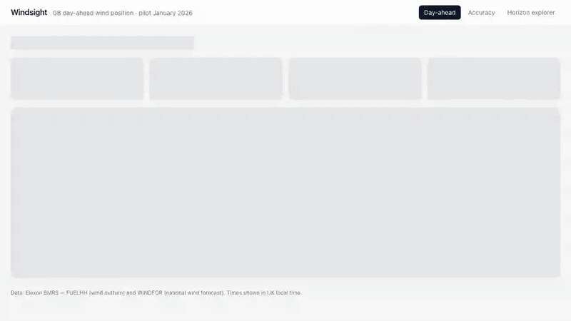

# Windsight

**Day-ahead wind forecast monitoring for UK power procurement.**
For each day-ahead purchase decision, Windsight shows the national wind generation forecast the
buyer actually had at the decision cutoff, and how accurate such forecasts have been, so the
residual volume and a safety buffer can be sized from measured error rather than gut feel.

Pilot scope: national wind only, Elexon BMRS data, purchase decisions made in **January 2026**
(delivery days 2 Jan – 1 Feb 2026).

- **Live app:** _TODO: add the Vercel/Heroku URL after deployment_
- **Architecture & design decisions:** [docs/architecture.md](docs/architecture.md)

## Demo

[](docs/demo/windsight-demo.mp4)

A two-minute walkthrough of the app on the real January 2026 Elexon data: the 09:00 decision
brief, hiding and revealing the outturn, stepping back to the worst day of the month, changing the
cutoff, CSV export, the accuracy backtest and the horizon explorer.

- **Full quality:** [`windsight-demo.mp4`](docs/demo/windsight-demo.mp4) (1280×720, subtitles
  burned in, plus a selectable English subtitle track)
- **Subtitles only:** [`.srt`](docs/demo/windsight-demo.srt) · [`.vtt`](docs/demo/windsight-demo.vtt)
- **Re-record it** (e.g. after a UI change): `pnpm --filter @windsight/web demo`. A scripted
  Playwright walkthrough ([`apps/web/demo/demo.spec.ts`](apps/web/demo/demo.spec.ts)) drives the
  real stack and records it; [`render.mjs`](apps/web/demo/render.mjs) uses ffmpeg to write the
  MP4, GIF and subtitle files to `docs/demo/`.

## Deploying

The API (FastAPI + Postgres) and the web app (Next.js) deploy separately. The browser only ever
talks to the web app; its server components call the API, so the API URL is a server-side
setting (`API_BASE_URL`) and is never exposed to the browser.

### Option 1: Heroku (API + Postgres) and Vercel (web)

**1. API on Heroku** (container stack, built from [`apps/api/Dockerfile`](apps/api/Dockerfile)
via [`heroku.yml`](heroku.yml)):

```bash
heroku login
heroku create <api-app> --stack container
heroku addons:create heroku-postgresql:essential-0 -a <api-app>
heroku config:set CORS_ORIGINS='["https://<web-app>.vercel.app"]' -a <api-app>
git push heroku main
```

Each deploy runs the release phase (`windsight release`): it applies Alembic migrations, then
idempotently loads the pilot window from Elexon, before the new version takes traffic. Heroku's
`postgres://` `DATABASE_URL` is normalised to the psycopg driver automatically, and the container
listens on Heroku's `$PORT`.

**2. Web on Vercel:**

1. Import the repository in Vercel.
2. Set **Root Directory** to `apps/web`. Vercel detects Next.js and the pnpm workspace.
3. Add the environment variable `API_BASE_URL=https://<api-app>.herokuapp.com`.
4. Deploy. Every push to `main` redeploys; pull requests get preview URLs.

### Option 2: one server with Docker Compose

On any host with Docker (a VM, for example):

```bash
git clone <repo-url> windsight && cd windsight
cp .env.example .env            # set a strong POSTGRES_PASSWORD
docker compose up -d --build    # db → migrate → ingest → api → web
```

The web app is served on port 3000 and the API on port 8000. Put a reverse proxy with TLS (Caddy,
nginx) in front of port 3000. On a public host, remove the `ports:` mapping of the `db` service
so Postgres is not exposed. To refresh data later: `docker compose run --rm ingest`.

### Configuration

| Variable                  | Service | Default                     | Purpose                                     |
| ------------------------- | ------- | --------------------------- | ------------------------------------------- |
| `DATABASE_URL`            | API     | local Postgres              | Postgres (or SQLite) connection string      |
| `CORS_ORIGINS`            | API     | `["http://localhost:3000"]` | JSON list of browser origins allowed        |
| `DEFAULT_DECISION_CUTOFF` | API     | `09:00`                     | Cutoff used when a request doesn't pass one |
| `LOG_LEVEL`               | API     | `INFO`                      | Python log level                            |
| `API_BASE_URL`            | Web     | `http://localhost:8000`     | Where the web server reaches the API        |

### Verify a deployment

```bash
curl -fsS https://<api-app>.herokuapp.com/health/ready          # API up, database reachable
curl -fsS https://<api-app>.herokuapp.com/api/v1/meta           # data coverage and freshness
curl -fsS https://<web-app>.vercel.app/api/health               # web up
```

Then run the browser end-to-end suite against the live URLs (no local servers are started):

```bash
E2E_BASE_URL=https://<web-app>.vercel.app E2E_API_URL=https://<api-app>.herokuapp.com \
  pnpm --filter @windsight/web test:e2e
```

## Key findings (January 2026, 09:00 cutoff)

- **The raw forecast runs high.** Day-ahead forecasts over-estimated wind on **27 of 31** days,
  by **1.7 GW** on average (MAE 2.0 GW, 18% of mean outturn). Taken at face value, it leads to
  under-buying.
- **A simple, leakage-free correction cuts error by 30%.** Subtracting the forecast's mean error
  over the previous 28 settled days brings MAE from **2.0 → 1.4 GW**.
- **The uncertainty band is honest.** The P10–P90 band built the same way captured **86%** of
  hours (target 80%), so the "firm wind" floor is safe to size purchases against.
- **Error grows with lead time**, from about 1.7 GW for the freshest forecasts to 2.4 GW at 47 h,
  so every hour of later cutoff buys accuracy.

## What it shows

| View                               | Question it answers                                                                                                                                                                                                                                                                              |
| ---------------------------------- | ------------------------------------------------------------------------------------------------------------------------------------------------------------------------------------------------------------------------------------------------------------------------------------------------ |
| **Day-ahead** (`/`)                | "At 09:00 on D-1, how much wind can I count on tomorrow?" A plain-English decision brief (firm wind at P90, bias-adjusted expectation, lowest-wind window), the forecast vs bias-adjusted vs actual chart with a calibrated P10–P90 band, toggles to hide the hindsight outturn, and CSV export. |
| **Accuracy** (`/accuracy`)         | "How wrong is the decision-time forecast, and does the correction help?" Generated key findings, MAE/bias/P90 cover, the out-of-sample backtest, and daily, hourly and horizon error views.                                                                                                      |
| **Horizon explorer** (`/explorer`) | "How does accuracy change if I use forecasts published N hours ahead?" (0–48 h slider, CSV export).                                                                                                                                                                                              |

The decision cutoff is adjustable (default 09:00 UK time); every view is a shareable URL.

## Stack

|            |                                                                                |
| ---------- | ------------------------------------------------------------------------------ |
| Monorepo   | Turborepo + pnpm workspaces                                                    |
| Frontend   | Next.js 16 (App Router, React 19, server components), Tailwind CSS 4, Recharts |
| Backend    | Python 3.12, FastAPI, SQLAlchemy 2, Alembic, httpx, NumPy, managed with uv     |
| Data       | PostgreSQL 17 (SQLite supported for Docker-less dev and tests)                 |
| Contract   | OpenAPI → `openapi-typescript` → typed `openapi-fetch` client                  |
| Containers | Docker multi-stage images + Docker Compose                                     |
| Quality    | ruff, mypy (strict), pytest · ESLint, TypeScript, Vitest, Playwright · CI      |

## Repository layout

```
.
├── apps/
│   ├── api/                      # Python backend (FastAPI), published as the `windsight` package
│   │   ├── src/windsight/
│   │   │   ├── api/              #   HTTP layer: routes, dependency wiring, request-id middleware
│   │   │   ├── core/             #   settings (env-driven), logging
│   │   │   ├── db/               #   SQLAlchemy models, engine/session
│   │   │   ├── elexon/           #   typed Elexon BMRS client (retries, validation)
│   │   │   ├── repositories/     #   all SQL for generation data, dialect-aware upserts
│   │   │   ├── schemas/          #   Pydantic response models (API contract)
│   │   │   ├── services/         #   use cases + pure domain rules (selection, metrics, calibration, ingestion)
│   │   │   ├── domain.py         #   value objects (ActualPoint, ForecastPoint)
│   │   │   ├── cli.py            #   `windsight ingest | release | export-openapi`
│   │   │   └── main.py           #   FastAPI app factory
│   │   ├── migrations/           # Alembic migrations
│   │   ├── tests/unit/           # pytest: pure domain rules, calibration (no leakage), Elexon client
│   │   ├── tests/integration/    # pytest: fake Elexon → ingestion → DB → API, migrations, CLI
│   │   ├── Dockerfile            # uv multi-stage image (api / migrate / ingest)
│   │   ├── package.json          # Turborepo bridge: scripts delegate to `uv run …`
│   │   └── pyproject.toml / uv.lock
│   └── web/                      # Next.js frontend
│       ├── src/app/              #   routes: / (day-ahead), /accuracy, /explorer, /api/health
│       ├── src/components/       #   charts (client), controls (URL state), ui primitives
│       ├── src/lib/              #   server-only API access, formatting, date and CSV helpers (+ Vitest)
│       ├── e2e/                  #   Playwright end-to-end tests against the real stack
│       ├── demo/                 #   scripted, recorded walkthrough → docs/demo (`pnpm demo`)
│       └── Dockerfile            #   turbo prune → standalone Next.js server
├── packages/
│   ├── api-client/               # generated OpenAPI types + typed fetch client (shared contract)
│   └── typescript-config/        # shared tsconfig presets
├── docs/
│   ├── architecture.md           # architecture, business rules, calibration, limitations
│   ├── demo/                     # demo video (MP4 + GIF) and subtitles (SRT, VTT)
│   └── demo-script.md            # talk track for the 2-part video (client pitch, tech review)
├── docker-compose.yml            # db → migrate → ingest → api → web
├── heroku.yml                    # API container deploy; release phase = `windsight release`
├── turbo.json                    # task pipeline (build, dev, lint, typecheck, test, codegen)
└── .github/workflows/ci.yml      # lint, types, unit/integration (SQLite + Postgres), e2e, contract, docker
```

## Getting started

### Option A: Docker (whole stack, one command)

Requires Docker Desktop.

```bash
docker compose up --build
```

This starts Postgres, applies migrations, ingests the January 2026 window from Elexon (about
23k rows, a few seconds), and serves:

- Web: http://localhost:3000
- API docs (Swagger): http://localhost:8000/docs

To re-ingest later (idempotent): `docker compose run --rm ingest`.

### Option B: local development (hot reload)

Requires Node ≥ 20.9 with pnpm (`corepack enable`), [uv](https://docs.astral.sh/uv/), and either
Docker (for Postgres) or nothing at all (SQLite).

```bash
pnpm install
cp .env.example apps/api/.env        # use DATABASE_URL=sqlite:///./windsight.db to skip Postgres
docker compose up -d db              # only if using Postgres
pnpm --filter @windsight/api db:migrate
pnpm --filter @windsight/api ingest
pnpm dev                             # API on :8000 and web on :3000, via Turborepo
```

### Common tasks

| Command                                      | What it does                                                          |
| -------------------------------------------- | --------------------------------------------------------------------- |
| `pnpm dev`                                   | Run API (uvicorn `--reload`) and web (Next dev) together              |
| `pnpm lint` / `pnpm typecheck` / `pnpm test` | Run across all workspaces (Python via uv)                             |
| `pnpm build`                                 | Production build of the web app                                       |
| `pnpm codegen`                               | Export FastAPI OpenAPI, then regenerate `@windsight/api-client` types |
| `pnpm --filter @windsight/api ingest`        | Load or refresh Elexon data                                           |

## Testing

Four layers, all run in CI ([`.github/workflows/ci.yml`](.github/workflows/ci.yml)):

| Layer                           | Where                        | What it checks                                                                                                                                                                                                                                                                       |
| ------------------------------- | ---------------------------- | ------------------------------------------------------------------------------------------------------------------------------------------------------------------------------------------------------------------------------------------------------------------------------------ |
| **API unit** (45)               | `apps/api/tests/unit`        | Pure rules with no I/O: which forecast run is in hand at the cutoff (UK clock changes included), calibration only from settled days (no D-1 leakage), error metrics, decision summary, Elexon client parsing, filtering and retries, settings.                                       |
| **API integration** (45)        | `apps/api/tests/integration` | The full flow against a real database: a deterministic fake Elexon → ingestion → database → every endpoint, checked against known answers. Also request validation, idempotent and failed ingestion, upserts, Alembic migrations matching the models, CLI, and the OpenAPI contract. |
| **Web unit + integration** (21) | `apps/web/src/**/*.test.ts`  | UK-time formatting, date helpers, CSV export, and the server-side data layer with the generated typed client (request building, API errors, API unreachable).                                                                                                                        |
| **End-to-end** (14)             | `apps/web/e2e`               | The real stack in Chromium: Elexon → API → production Next.js build. Checks every view and control (date stepping, cutoff, toggles, slider, CSV downloads, navigation), that on-screen numbers match the API, and that there are no console errors.                                  |

```bash
pnpm test                                        # API unit + integration, web unit + integration
pnpm --filter @windsight/api test:unit           # or test:integration
TEST_DATABASE_URL=postgresql://user@localhost:5432/scratch \
  pnpm --filter @windsight/api test:integration  # same suite on PostgreSQL (tables are recreated)
pnpm --filter @windsight/web exec playwright install chromium   # once
pnpm --filter @windsight/web test:e2e            # starts API (:8200) + web (:3200), loads Elexon data
```

## API

| Endpoint                                                      | Description                                                                                                    |
| ------------------------------------------------------------- | -------------------------------------------------------------------------------------------------------------- |
| `GET /api/v1/meta`                                            | Pilot window, defaults, data coverage and freshness                                                            |
| `GET /api/v1/day-ahead?delivery_date=YYYY-MM-DD&cutoff=HH:MM` | Forecast in hand at the D-1 cutoff, bias-adjusted values, P10–P90 band, decision summary, actuals              |
| `GET /api/v1/accuracy/day-ahead?cutoff=HH:MM`                 | Decision-time error over the pilot (raw and bias-corrected backtest, band coverage), daily, by hour, histogram |
| `GET /api/v1/accuracy/horizon`                                | Error by lead time (0–48 h)                                                                                    |
| `GET /api/v1/series?start=&end=&horizon_hours=`               | Actual vs latest forecast published ≥ N h ahead                                                                |
| `GET /health`, `GET /health/ready`                            | Liveness / readiness (DB)                                                                                      |

Every response carries `X-Request-ID` and `Server-Timing` headers. Interactive docs: `/docs`.

Error convention: **error = forecast − actual** (positive means wind under-delivered).

## Data sources

- Actuals: Elexon [FUELHH stream](https://bmrs.elexon.co.uk/api-documentation/endpoint/datasets/FUELHH/stream), `fuelType = WIND`, 30-minute resolution.
- Forecasts: Elexon [WINDFOR stream](https://bmrs.elexon.co.uk/api-documentation/endpoint/datasets/WINDFOR/stream), hourly targets, about 8 runs per day.

## AI tools

This project was built with help from AI coding tools (Claude Code, Anthropic) for scaffolding,
implementation and documentation. All code was reviewed, run and tested by the author.
